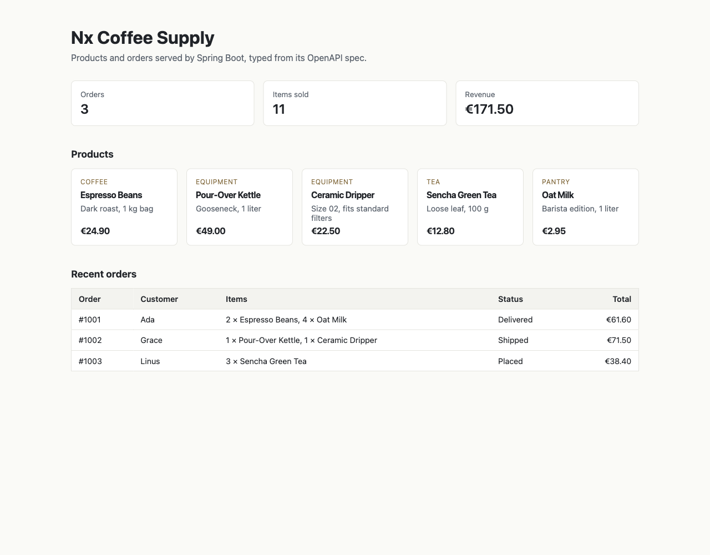

# Nx polyglot: Spring Boot + TanStack Start

A full-stack example workspace: a modular Spring Boot API (Gradle) and a TanStack Start storefront in one Nx monorepo. The storefront's TypeScript types are generated from the API's OpenAPI spec, and the Nx task graph keeps both sides in sync. Rename a field on a Java record and the storefront stops typechecking.

**Blog post:** [Full-Stack Type Safety from Spring Boot to TanStack with Nx](https://nx.dev/blog/spring-boot-openapi-type-safety) walks through this repository step by step.



## Run the demo

The workspace expects Node 24, pnpm 11 and [mise](https://mise.jdx.dev/) for Java (`mise.toml` pins Temurin 25). The Gradle wrapper is committed.

```sh
mise trust && mise install
pnpm install
pnpm nx dev storefront
```

`storefront:dev` starts the whole stack:

```text
storefront:dev                       Vite on http://localhost:3000
  -> ^codegen                        TypeScript types from the OpenAPI spec
       -> products-api:generateOpenApi
  -> products-api:serve (continuous) Spring Boot on http://localhost:8080
```

Without mise activated in your shell, prefix commands with `mise exec --`.

## How the type sync works

1. **The API emits its spec at build time.** `products-api:generateOpenApi` is a Gradle task that boots the Spring context with MockMvc and writes `build/openapi/openapi.json`. No server, no port, deterministic output.
2. **Nx picks the task up.** `@nx/gradle` turns every Gradle task into an Nx target, so `generateOpenApi` is cacheable and part of the task graph.
3. **Types come from the spec.** `api-types:codegen` runs `openapi-ts` on the spec. It hashes the spec file, not the Java sources, so a Java change that doesn't change the contract reuses the cached types.
4. **Consumers pull codegen in.** Target defaults in `nx.json` make `typecheck`, `build` and `dev` depend on `codegen`, so the storefront always checks against fresh types.

Try it:

- Rename `Product.name` to `title` in `libs/backend/catalog-data` and run `pnpm nx typecheck storefront`. The spec and types regenerate, and the storefront fails with `Property 'name' does not exist on type 'Product'`.
- Edit only the Javadoc on `Product`. Java compile and `generateOpenApi` rerun, but `codegen` and both typechecks come from the cache, because the spec didn't change.
- `pnpm nx show projects --affected` after a Java change lists the Java and TypeScript projects. After a storefront-only change, it lists only `storefront`.

## CI on Nx Cloud

CI runs on [Nx Cloud CI](https://nx.dev/docs/features/ci-features#run-ci-on-nx-cloud), not GitHub Actions. Everything is in [`.nx/pipelines/ci.yaml`](./.nx/pipelines/ci.yaml):

- **Triggers:** every push to `main` and every pull request. GitHub shows one status check, `Nx Cloud: CI`.
- **Job:** runs `nx sync:check`, `nx format:check` and `nx affected -t build typecheck test e2e-ci`. Nx Cloud sets the affected base and head SHAs and runs self-healing CI on failures, so there is no `nx-set-shas` or `nx fix-ci` step.
- **Distribution:** tasks run on three `linux-medium-polyglot` workers plus one on the main job's machine. Java tasks, TypeScript tasks and the Playwright specs (one task per spec file) all go through the same pipeline.
- **Launch template:** the standard Node 24 image plus Java from `mise.toml` and Playwright's Chromium headless shell, with caches for the pnpm store and `~/.gradle/caches`. The main job needs Java too, because `@nx/gradle` asks Gradle for the project graph before anything is distributed.

To turn it on in your fork: run `pnpm nx connect`, install the Nx Cloud GitHub App on the repository and enable Nx Cloud CI for the workspace.

## Bringing in an existing Spring Boot app

The API started as a standalone spike and was brought in with `nx import`, which keeps its git history. The [Agentic Nx Import video](https://youtu.be/mUG292kkz0w) walks through importing a multi-module Gradle Spring Boot project into an Nx workspace.

## For your agents

Details for coding agents (and humans) working in this repository.

### Projects

| Nx project            | Path                        | Notes                                                                             |
| --------------------- | --------------------------- | --------------------------------------------------------------------------------- |
| `catalog-data`        | `libs/backend/catalog-data` | Gradle. `Product` record and a hard-coded `ProductRepository`.                    |
| `orders`              | `libs/backend/orders`       | Gradle. `OrderService` prices orders from the catalog.                            |
| `products-api`        | `apps/products-api`         | Gradle, Spring Boot: `/products`, `/products/{id}`, `/orders`, `/orders/summary`. |
| `api-types`           | `libs/shared/api-types`     | Generated TypeScript types (`src/generated`, gitignored).                         |
| `storefront-products` | `libs/frontend/products`    | React components for the product list.                                            |
| `storefront-orders`   | `libs/frontend/orders`      | React components for orders.                                                      |
| `storefront`          | `apps/storefront`           | TanStack Start app. Fetches through a server function (`src/lib/shop-api.ts`).    |
| `storefront-e2e`      | `apps/storefront-e2e`       | Playwright tests against the built storefront and the running API.                |

```
catalog-data <── orders <── products-api <·· api-types <── storefront-products <──┐
                                         (implicit)    <── storefront-orders   <──┴── storefront <·· storefront-e2e
                                                                                                  (implicit)
```

The Java modules are one Gradle build (`settings.gradle.kts`); the TypeScript side is a pnpm workspace. The feature libs import only from `@shop/api-types`, never each other. `API_URL` overrides where the storefront's server functions reach the API (default `http://localhost:8080`).

### Commands

```sh
pnpm nx run-many -t build test typecheck   # everything
pnpm nx run products-api:generateOpenApi   # writes apps/products-api/build/openapi/openapi.json
pnpm nx codegen api-types                  # writes libs/shared/api-types/src/generated
pnpm nx serve products-api                 # Spring Boot on :8080
pnpm nx preview storefront                 # built storefront on :4173, plus the API on :8080
pnpm nx e2e storefront-e2e                 # all Playwright specs in one task
pnpm nx show project products-api          # inferred Gradle targets
```

Run `pnpm exec playwright install chromium` once before the e2e tests.

### Codegen wiring

`libs/shared/api-types/package.json`:

```json
"implicitDependencies": ["products-api"],
"targets": {
  "codegen": {
    "dependsOn": ["^generateOpenApi"],
    "inputs": [
      { "dependentTasksOutputFiles": "**/build/openapi/openapi.json" },
      "{projectRoot}/package.json",
      "sharedGlobals"
    ],
    "outputs": ["{projectRoot}/src/generated"],
    "cache": true
  }
}
```

`implicitDependencies` is the edge that makes `nx affected` see a Java change as affecting the storefront; the generated code is gitignored, so there's no import Nx could read instead.

`nx.json` target defaults:

```json
"typecheck": {
  "dependsOn": ["...", "codegen"],
  "inputs": ["...", { "dependentTasksOutputFiles": "**/*.ts", "transitive": true }]
},
"build": { "dependsOn": ["...", "^codegen"] },
"dev":   { "dependsOn": ["...", "^codegen"] }
```

`generateOpenApi` is a Gradle `Test` task in its own `openapi` source set, and `check` depends on it. Its output is deterministic (fixed locale and timezone, sorted keys, fixed server URL and version). An `OpenApiCustomizer` marks every record component as required; without it, every generated field is optional.

### End-to-end tests

The `webServer` in `playwright.config.mts` is `nx run storefront:preview` with `reuseExistingServer: true`, so Nx runs the server as a task before the tests: `storefront:preview` builds the storefront and depends on `products-api:serve`. Both set a target-level `readyWhen` URL.

`@nx/playwright` splits the suite into one `e2e-ci--src/<spec>` task per spec file; `e2e-ci` only runs on Nx Cloud workers. Locally, use `nx e2e storefront-e2e`.

Each spec declares the projects it exercises on its first line, so its cached result is reused when nothing it tests changed:

| Spec               | Directive                                              |
| ------------------ | ------------------------------------------------------ |
| `products.spec.ts` | `// @nx-depends-on: storefront-products, products-api` |
| `orders.spec.ts`   | `// @nx-depends-on: storefront-orders, products-api`   |
| `summary.spec.ts`  | `// @nx-depends-on: storefront-orders, products-api`   |
| `smoke.spec.ts`    | none, reruns on any storefront change                  |

The app itself is never listed, because that would put every feature back in the hash. Check a spec's inputs with `pnpm nx show target inputs storefront-e2e:e2e-ci--src/orders.spec.ts --check <file>`. In CI, [Ultracache](https://nx.dev/docs/features/ci-features/remote-cache#ultracache) records which files each spec actually read and keeps only those in the hash.

## Learn more

- [Full-Stack Type Safety from Spring Boot to TanStack with Nx](https://nx.dev/blog/spring-boot-openapi-type-safety)
- [5 Ways We Solve the CI Bottleneck](https://nx.dev/blog/five-things-faster-cheaper-ci)
- Nx Cloud CI is currently in private beta. [Sign up to get early access](https://nx.dev/nx-cloud-ci-beta#request-access).
- [Nx on YouTube](https://www.youtube.com/@nxdevtools)
- Follow Nx on [X](https://x.com/nxdevtools), [Bluesky](https://bsky.app/profile/nx.dev) and [LinkedIn](https://www.linkedin.com/company/nrwl)
